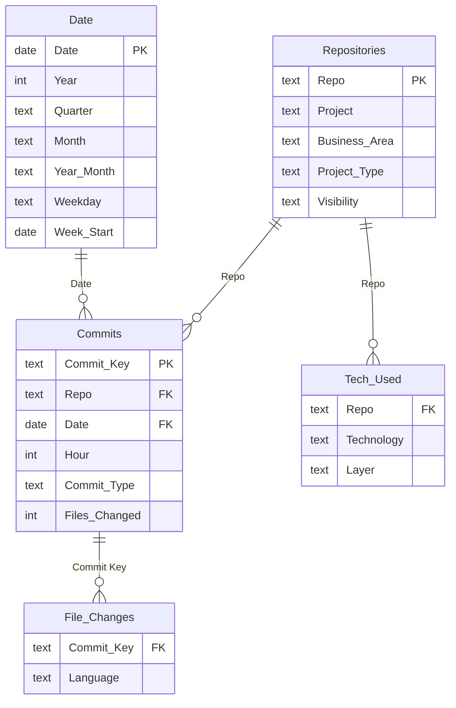

# GitHub Dev Portfolio

> **Business question:** What have I built, what is it built with, and how does the work break down?

Full commit history from 13 of my repositories (March to November 2026): BrightBase (an operations platform), client websites, my studio site, a marketplace app and internal tools.

## What it shows

1. 1,274 pull requests over 160 active days in eight months.
2. Nearly two-thirds of commits went into BrightBase, the platform that replaced the company's field-service, scheduling and CRM tools.
3. Feature commits outnumber fixes about 1.7 to 1.
4. Files changed: JavaScript 34%, Python 28%, TypeScript 26%. React, Tailwind and TypeScript are the most common front-end stack; FastAPI with SQLAlchemy/Alembic on the back end.

## Pages

| Page | What's on it |
|---|---|
| **Overview** | Commits, active days, pull requests and feature commits; weekly commit trend; files changed by language; commits by project; monthly commit mix. |
| **Projects** | Project register with first/last commit, activity and feature share; features vs. fixes per project; project × month matrix. |
| **Work Patterns** | Commits by weekday and hour, commit-type mix, active days per month. |
| **Tech Stack** | Technologies declared in each repo's package.json / requirements.txt, by project and layer. |

## Data model



| Table | Role | Rows describe |
|---|---|---|
| `Commits` | Fact | One row per commit across all repositories (merge and bot commits excluded). |
| `Date` | Date dimension | Calendar table generated for this report (one row per day). |
| `File Changes` | Fact | Files changed per commit, grouped by language (from file extension). |
| `Repositories` | Dimension | One row per GitHub repository, with the project it belongs to. |
| `Tech Used` | Dimension | Technologies declared in each repo's dependency files. |

## Key DAX measures

**Pull Requests** · Distinct pull requests referenced by squash-merge commit messages.

```dax
CALCULATE(DISTINCTCOUNT(Commits[PR Key]), NOT ISBLANK(Commits[PR Key]))
```

**Commits per Active Day**

```dax
DIVIDE([Total Commits], [Active Days])
```

**Feature Share**

```dax
DIVIDE([Features], [Total Commits])
```

**Commits Last 30 Days**

```dax
VAR LastDay = CALCULATE(MAX(Commits[Date]), ALL(Commits))
RETURN CALCULATE([Total Commits], Commits[Date] > LastDay - 30)
```

**Language Share**

```dax
DIVIDE([File Edits], CALCULATE([File Edits], ALL('File Changes'[Language])))
```

<details><summary>All 15 measures</summary>

| Measure | Table | Definition |
|---|---|---|
| Total Commits | Commits | `COUNTROWS(Commits)` |
| Active Days | Commits | `DISTINCTCOUNT(Commits[Date])` |
| Repos Touched | Commits | `DISTINCTCOUNT(Commits[Repo])` |
| Pull Requests | Commits | `CALCULATE(DISTINCTCOUNT(Commits[PR Key]), NOT ISBLANK(Commits[PR Key]))` |
| Features | Commits | `CALCULATE([Total Commits], Commits[Commit Type] = "Feature")` |
| Fixes | Commits | `CALCULATE([Total Commits], Commits[Commit Type] = "Fix")` |
| Feature Share | Commits | `DIVIDE([Features], [Total Commits])` |
| Commits per Active Day | Commits | `DIVIDE([Total Commits], [Active Days])` |
| Files Changed (Total) | Commits | `SUM(Commits[Files Changed])` |
| First Commit | Commits | `MIN(Commits[Date])` |
| Last Commit | Commits | `MAX(Commits[Date])` |
| Commits Last 30 Days | Commits | `VAR LastDay = CALCULATE(MAX(Commits[Date]), ALL(Commits)) RETURN CALCULATE([Total Commits], Commits[Date] > LastDay - 30)` |
| File Edits | File Changes | `SUM('File Changes'[Files])` |
| Language Share | File Changes | `DIVIDE([File Edits], CALCULATE([File Edits], ALL('File Changes'[Language])))` |
| Repos Using | Tech Used | `DISTINCTCOUNT('Tech Used'[Repo])` |

</details>

## Data preparation

- Read commit metadata from each repo's git history (merges and bot commits excluded). No source code or commit messages are included.
- Classified each commit (Feature, Fix, UX & polish, Security & deps, Docs, Tests) from its message prefix and leading verbs.
- Mapped file extensions to languages and parsed each repo's dependency files into a technology list.
- Converted commit times to Eastern time for the work-pattern page.

## Open it

Open the `.pbip` file in this folder with Power BI Desktop and click **Refresh**. The data is embedded in the model, so there's nothing to connect.

[← Back to all reports](../README.md)
