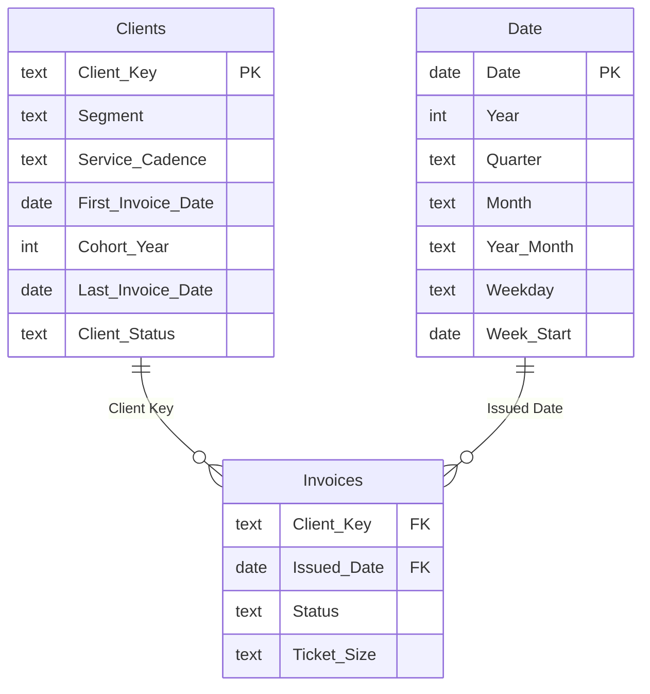

# Maine Cleaning Co · Operations Report

> **Business question:** Where does revenue come from, which clients stay, and how seasonal is short-term-rental work?

The Maine Cleaning Company is a residential, commercial and Airbnb/VRBO turnover cleaning business I run in southern Maine. This report uses every Jobber invoice from March 2023 to October 2026.

## What it shows

1. Commercial clients are 5% of clients and 41% of revenue. Their average invoice is 2.7× a residential clean.
2. The top 10 clients account for 51% of revenue, a concentration worth managing.
3. 63% of clients booked more than once. The cohort table shows how long each year's new clients kept booking.
4. July and August hold 34% of the year's rental turnovers; January and February together hold about 7%.

## Pages

| Page | What's on it |
|---|---|
| **Overview** | Revenue, year-over-year growth, invoices, clients and retention; monthly revenue by year for seasonality; segment mix; ticket-size distribution. |
| **Clients & Retention** | New clients per quarter, cohort table of clients still booking in later years, top-15 clients, service cadence (weekly / bi-weekly / monthly) by segment. |
| **STR Turnovers** | Turnover volume by month and year, average turnover ticket by quarter, revenue by rental client, rental share of monthly revenue. |
| **Segments** | Revenue and like-for-like growth by segment and year, average invoice by segment, rolling 3-month revenue trend. |

## Data model



| Table | Role | Rows describe |
|---|---|---|
| `Clients` | Dimension | One row per client. Names removed; keys are anonymized. |
| `Date` | Date dimension | Calendar table generated for this report (one row per day). |
| `Invoices` | Fact | One row per Jobber invoice, 2023 to present. |

## Key DAX measures

**Revenue PY** · Same dates one year earlier (like-for-like).

```dax
VAR firstD = CALCULATE(MIN(Invoices[Issued Date]), ALL(Invoices))
VAR lastD = CALCULATE(MAX(Invoices[Issued Date]), ALL(Invoices))
VAR yr = IF(HASONEVALUE('Date'[Year]), VALUES('Date'[Year]), YEAR(lastD))
VAR cur = CALCULATETABLE(VALUES('Date'[Date]), 'Date'[Year] = yr, KEEPFILTERS(FILTER(ALL('Date'[Date]), 'Date'[Date] <= lastD && EDATE('Date'[Date], -12) >= firstD)))
RETURN CALCULATE([Revenue], SAMEPERIODLASTYEAR(cur))
```

**Revenue YoY %** · Like-for-like growth: selected year (or latest year) vs. the same dates the year before.

```dax
VAR py = [Revenue PY]
RETURN IF(NOT ISBLANK(py), DIVIDE([Revenue LFL] - py, py))
```

**Client Retention YoY** · Of the clients invoiced in the same period last year, the share also invoiced this period.

```dax
VAR firstD = CALCULATE(MIN(Invoices[Issued Date]), ALL(Invoices))
VAR lastD = CALCULATE(MAX(Invoices[Issued Date]), ALL(Invoices))
VAR yr = IF(HASONEVALUE('Date'[Year]), VALUES('Date'[Year]), YEAR(lastD))
VAR cur = CALCULATETABLE(VALUES('Date'[Date]), 'Date'[Year] = yr, KEEPFILTERS(FILTER(ALL('Date'[Date]), 'Date'[Date] <= lastD && EDATE('Date'[Date], -12) >= firstD)))
VAR curC = CALCULATETABLE(VALUES(Invoices[Client Key]), cur)
VAR prevC = CALCULATETABLE(VALUES(Invoices[Client Key]), SAMEPERIODLASTYEAR(cur))
RETURN DIVIDE(COUNTROWS(INTERSECT(curC, prevC)), COUNTROWS(prevC))
```

**Top 10 Client Share** · Revenue concentration: share of revenue from the ten largest clients in the period.

```dax
DIVIDE(SUMX(TOPN(10, VALUES(Invoices[Client Key]), [Revenue]), [Revenue]), [Revenue])
```

**Revenue (Top 15 Clients)** · Revenue shown only for the 15 largest clients in the current selection.

```dax
IF(NOT ISBLANK([Revenue]) && RANKX(ALLSELECTED(Clients[Client Key]), [Revenue]) <= 15, [Revenue])
```

**Revenue Rolling 3M**

```dax
VAR lastD = CALCULATE(MAX(Invoices[Issued Date]), ALL(Invoices))
RETURN IF(MIN('Date'[Date]) <= lastD, CALCULATE([Revenue], DATESINPERIOD('Date'[Date], MAX('Date'[Date]), -3, MONTH)))
```

<details><summary>All 25 measures</summary>

| Measure | Table | Definition |
|---|---|---|
| Client Count | Clients | `COUNTROWS(Clients)` |
| New Clients | Clients | `VAR s = MIN('Date'[Date]) VAR e = MAX('Date'[Date]) RETURN COUNTROWS(FILTER(Clients, Clients[First Invoice Date] >= s && Clients[First Invoice Date] <= e))` |
| Currently Active Clients | Clients | `CALCULATE(COUNTROWS(Clients), Clients[Client Status] = "Active")` |
| Repeat Client Rate | Clients | `DIVIDE(COUNTROWS(FILTER(Clients, Clients[Lifetime Invoices] > 1)), COUNTROWS(Clients))` |
| Avg Lifetime Value | Clients | `AVERAGE(Clients[Lifetime Revenue])` |
| Revenue | Invoices | `SUM(Invoices[Amount])` |
| Invoice Count | Invoices | `COUNTROWS(Invoices)` |
| Avg Invoice | Invoices | `DIVIDE([Revenue], [Invoice Count])` |
| Active Clients | Invoices | `DISTINCTCOUNT(Invoices[Client Key])` |
| Revenue per Client | Invoices | `DIVIDE([Revenue], [Active Clients])` |
| Revenue LFL | Invoices | `VAR firstD = CALCULATE(MIN(Invoices[Issued Date]), ALL(Invoices)) VAR lastD = CALCULATE(MAX(Invoices[Issued Date]), ALL(Invoices)) VAR yr = IF(HASONEVALUE('Date'[Year]), VALUES('Date'[Year]), YEAR(lastD)) VAR cur = CALCULATETABLE(VALUES('Date'[Date]), 'Date'[Year] = yr, KEEPFILTERS(FILTER(ALL('Date'[Date]), 'Date'[Date] <= lastD && EDATE('Date'[Date], -12) >= firstD))) RETURN CALCULATE([Revenue], cur)` |
| Revenue PY | Invoices | `VAR firstD = CALCULATE(MIN(Invoices[Issued Date]), ALL(Invoices)) VAR lastD = CALCULATE(MAX(Invoices[Issued Date]), ALL(Invoices)) VAR yr = IF(HASONEVALUE('Date'[Year]), VALUES('Date'[Year]), YEAR(lastD)) VAR cur = CALCULATETABLE(VALUES('Date'[Date]), 'Date'[Year] = yr, KEEPFILTERS(FILTER(ALL('Date'[Date]), 'Date'[Date] <= lastD && EDATE('Date'[Date], -12) >= firstD))) RETURN CALCULATE([Revenue], SAMEPERIODLASTYEAR(cur))` |
| Revenue YoY % | Invoices | `VAR py = [Revenue PY] RETURN IF(NOT ISBLANK(py), DIVIDE([Revenue LFL] - py, py))` |
| Revenue YTD | Invoices | `TOTALYTD([Revenue], 'Date'[Date])` |
| Revenue Rolling 3M | Invoices | `VAR lastD = CALCULATE(MAX(Invoices[Issued Date]), ALL(Invoices)) RETURN IF(MIN('Date'[Date]) <= lastD, CALCULATE([Revenue], DATESINPERIOD('Date'[Date], MAX('Date'[Date]), -3, MONTH)))` |
| Client Retention YoY | Invoices | `VAR firstD = CALCULATE(MIN(Invoices[Issued Date]), ALL(Invoices)) VAR lastD = CALCULATE(MAX(Invoices[Issued Date]), ALL(Invoices)) VAR yr = IF(HASONEVALUE('Date'[Year]), VALUES('Date'[Year]), YEAR(lastD)) VAR cur = CALCULATETABLE(VALUES('Date'[Date]), 'Date'[Year] = yr, KEEPFILTERS(FILTER(ALL('Date'[Date]), 'Date'[Date] <= lastD && EDATE('Date'[Date], -12) >= firstD))) VAR curC = CALCULATETABLE(VALUES(Invoices[Client Key]), cur) VAR prevC = CALCULATETABLE(VALUES(Invoices[Client Key]), SAMEPERIODLASTYEAR(cur)) RETURN DIVIDE(COUNTROWS(INTERSECT(curC, prevC)), COUNTROWS(prevC))` |
| Top 10 Client Share | Invoices | `DIVIDE(SUMX(TOPN(10, VALUES(Invoices[Client Key]), [Revenue]), [Revenue]), [Revenue])` |
| STR Revenue | Invoices | `CALCULATE([Revenue], Clients[Segment] = "Short-term rental")` |
| STR Turnovers | Invoices | `CALCULATE([Invoice Count], Clients[Segment] = "Short-term rental")` |
| STR Avg Ticket | Invoices | `DIVIDE([STR Revenue], [STR Turnovers])` |
| STR Properties | Invoices | `CALCULATE([Active Clients], Clients[Segment] = "Short-term rental")` |
| STR Share of Revenue | Invoices | `DIVIDE([STR Revenue], [Revenue])` |
| Revenue (Top 15 Clients) | Invoices | `IF(NOT ISBLANK([Revenue]) && RANKX(ALLSELECTED(Clients[Client Key]), [Revenue]) <= 15, [Revenue])` |
| STR Revenue (Top 15) | Invoices | `IF(NOT ISBLANK([STR Revenue]) && RANKX(ALLSELECTED(Clients[Client Key]), [STR Revenue]) <= 15, [STR Revenue])` |
| Outstanding Balance | Invoices | `SUMX(FILTER(Invoices, Invoices[Status] = "Past due"), Invoices[Amount])` |

</details>

## Data preparation

- Exported all 3,113 invoices from the Jobber API and de-duplicated them.
- Classified each client as Commercial, Residential or Short-term rental from the client name and invoice subjects.
- Derived **service cadence** from the median gap between each client's invoices, and **client status** (active within 60 days of the latest invoice).
- Replaced client names with keys like `RES-042` (segment + order of first invoice). Dollar amounts are multiplied by one constant factor, so ratios and trends are exact but totals are not real.

## Open it

Open the `.pbip` file in this folder with Power BI Desktop and click **Refresh**. The data is embedded in the model, so there's nothing to connect.

[← Back to all reports](../README.md)
