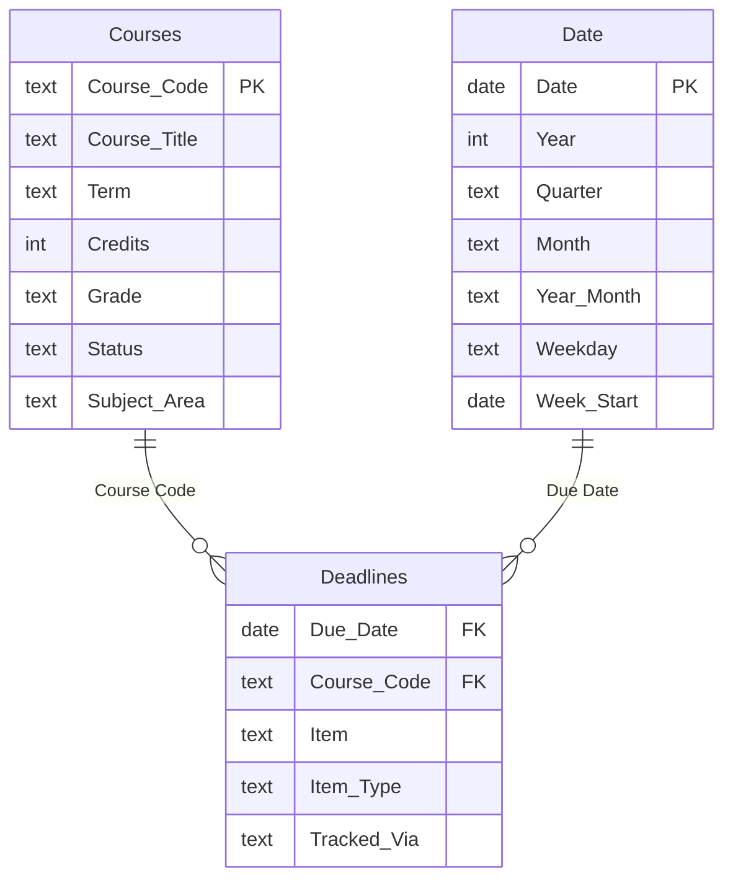

# USM Academic Progress

> **Business question:** How far along is the degree, how heavy is this term, and how many terms are left?

B.S. in Business Analytics & AI with a Computer Science minor at the University of Southern Maine, in progress, studying full time while running a business.

## What it shows

1. 39 of 120 credits done or in progress after Fall 2026 (25 earned, 14 in progress).
2. The busiest week of the term has 8 graded deadlines.
3. 16 of 73 deadlines never reach the course calendar feed and are tracked by hand.

## Pages

| Page | What's on it |
|---|---|
| **Degree Progress** | Credits earned, in progress and remaining; GPA; credits by subject area; course history. |
| **Fall 2026 Workload** | 73 graded deadlines by week, course and type; busiest week; deadlines that had to be tracked by hand. |
| **Path to Graduation** | What-if slider for credits per term and the number of terms remaining. |

## Data model



| Table | Role | Rows describe |
|---|---|---|
| `Courses` | Dimension | Courses toward the B.S. in Business Analytics & AI (120 credits required). |
| `Credentials` | Dimension | Learning outside the degree. |
| `Credit Load` | Parameter | What-if parameter: credits taken per term. |
| `Date` | Date dimension | Calendar table generated for this report (one row per day). |
| `Deadlines` | Fact | Fall 2026 deadlines from the school Google Calendar (Brightspace feeds plus hand-entered MAT 101 / BUS 260 dates). |

## Key DAX measures

**USM GPA** · Credit-weighted GPA over graded USM courses.

```dax
VAR graded = FILTER(Courses, NOT ISBLANK(Courses[Grade Points]))
RETURN DIVIDE(SUMX(graded, Courses[Credits] * Courses[Grade Points]), SUMX(graded, Courses[Credits]))
```

**Degree Progress %**

```dax
DIVIDE([Credits Earned], [Degree Credits Required])
```

**Terms Remaining** · Terms needed after Fall 2026 at the selected credit load (summer and winter sessions count as terms).

```dax
ROUNDUP(DIVIDE([Credits Remaining], [Selected Credit Load]), 0)
```

**Busiest Week Load** · Most deadlines landing in any single week.

```dax
MAXX(VALUES('Date'[Week Start]), [Deadline Count])
```

<details><summary>All 20 measures</summary>

| Measure | Table | Definition |
|---|---|---|
| Degree Credits Required | Courses | `120` |
| Credits Earned | Courses | `CALCULATE(SUM(Courses[Credits]), Courses[Status] IN {"Completed", "Transferred"})` |
| Credits In Progress | Courses | `CALCULATE(SUM(Courses[Credits]), Courses[Status] = "In progress")` |
| Credits Earned + In Progress | Courses | `[Credits Earned] + [Credits In Progress]` |
| Credits Remaining | Courses | `[Degree Credits Required] - [Credits Earned] - [Credits In Progress]` |
| Degree Progress % | Courses | `DIVIDE([Credits Earned], [Degree Credits Required])` |
| Progress incl. Current Term % | Courses | `DIVIDE([Credits Earned + In Progress], [Degree Credits Required])` |
| USM GPA | Courses | `VAR graded = FILTER(Courses, NOT ISBLANK(Courses[Grade Points])) RETURN DIVIDE(SUMX(graded, Courses[Credits] * Courses[Grade Points]), SUMX(graded, Courses[Credits]))` |
| Course Count | Courses | `COUNTROWS(Courses)` |
| Target Graduation | Courses | `"Dec 2028"` |
| Credential Count | Credentials | `COUNTROWS(Credentials)` |
| Selected Credit Load | Credit Load | `SELECTEDVALUE('Credit Load'[Credits per Term], 14)` |
| Terms Remaining | Credit Load | `ROUNDUP(DIVIDE([Credits Remaining], [Selected Credit Load]), 0)` |
| Deadline Count | Deadlines | `COUNTROWS(Deadlines)` |
| Exams | Deadlines | `CALCULATE([Deadline Count], Deadlines[Item Type] = "Exam")` |
| Quizzes | Deadlines | `CALCULATE([Deadline Count], Deadlines[Item Type] = "Quiz")` |
| Upcoming Deadlines | Deadlines | `CALCULATE([Deadline Count], Deadlines[Due Date] >= TODAY())` |
| Next 14 Days | Deadlines | `CALCULATE([Deadline Count], Deadlines[Due Date] >= TODAY(), Deadlines[Due Date] < TODAY() + 14)` |
| Busiest Week Load | Deadlines | `MAXX(VALUES('Date'[Week Start]), [Deadline Count])` |
| Hand-Tracked Share | Deadlines | `DIVIDE(CALCULATE([Deadline Count], Deadlines[Tracked Via] = "Added by hand"), [Deadline Count])` |

</details>

## Data preparation

- Deadlines pulled from the Brightspace calendar feeds plus hand-entered dates, de-duplicated across calendars.
- Credit-load what-if built as a parameter table with a `SELECTEDVALUE` measure.

## Open it

Open the `.pbip` file in this folder with Power BI Desktop and click **Refresh**. The data is embedded in the model, so there's nothing to connect.

[← Back to all reports](../README.md)
